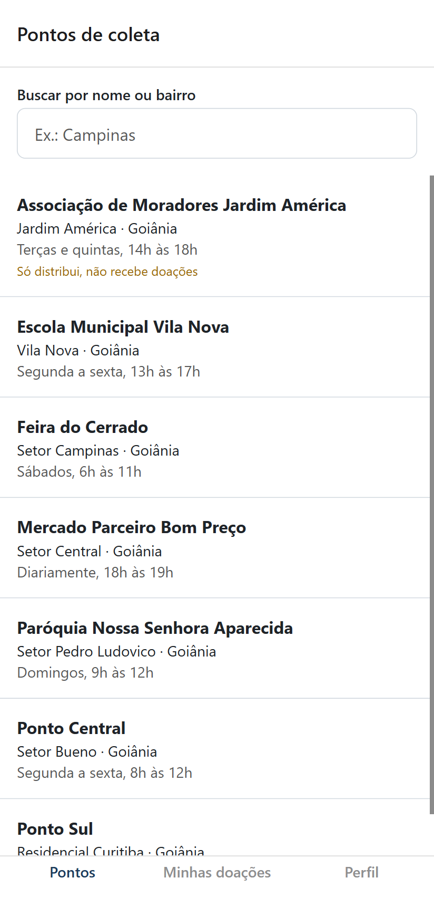
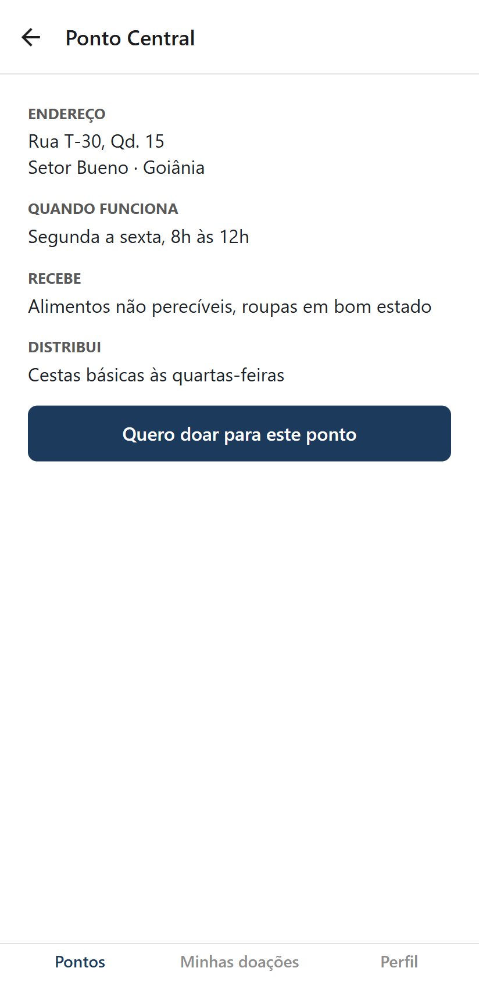
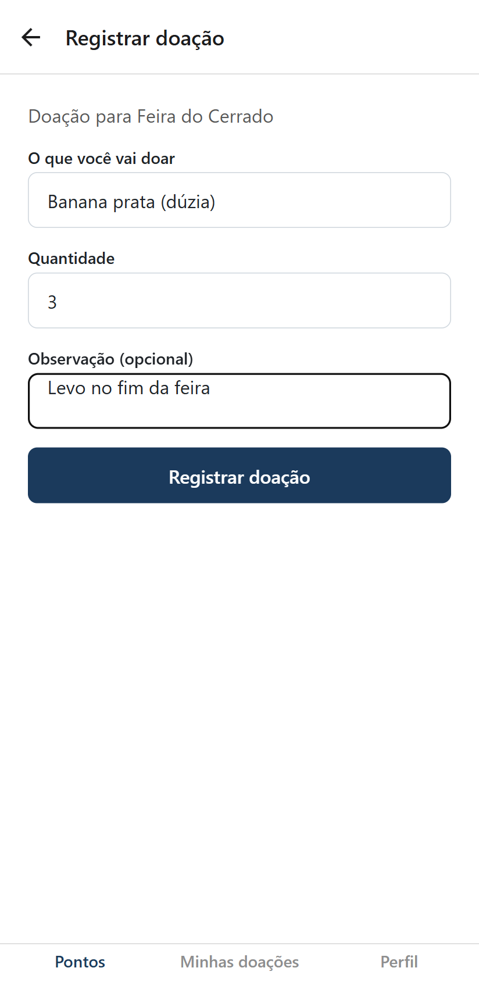
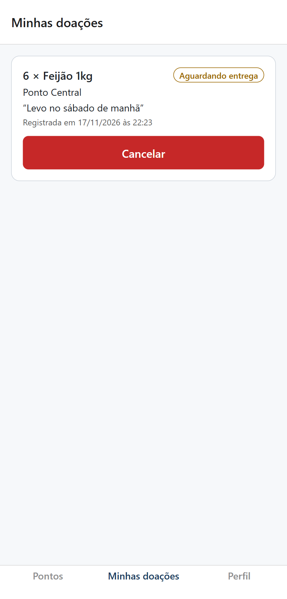
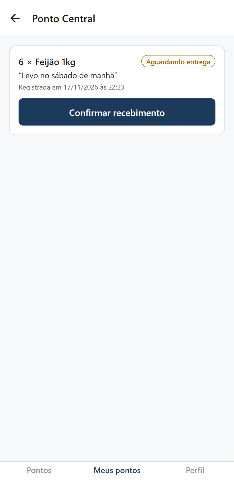
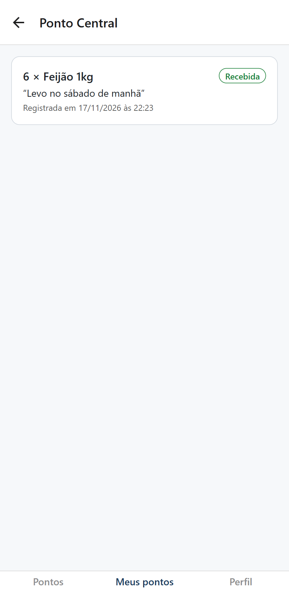
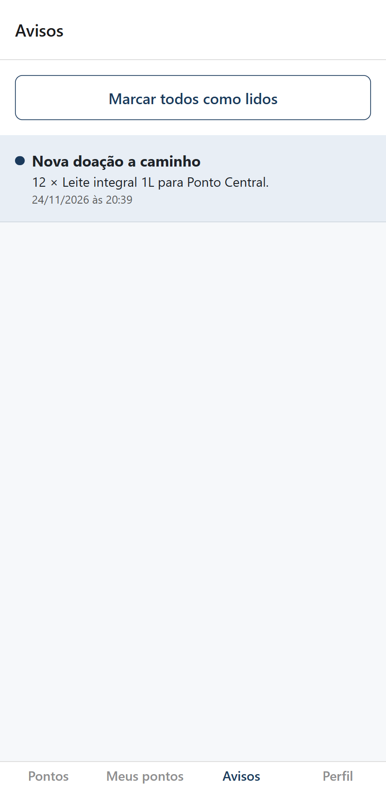
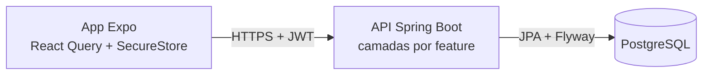

# Instituto Mão Amiga

[](https://github.com/jonatasEdward/instituto-mao-amiga/actions/workflows/api.yml)
[](https://github.com/jonatasEdward/instituto-mao-amiga/actions/workflows/mobile.yml)
[](LICENSE)

App mobile e API para conectar quem quer doar aos pontos de coleta de Goiânia. O doador encontra um ponto, registra o que vai levar e acompanha se a doação chegou. Quem cuida do ponto vê o que está a caminho e confirma o recebimento.

**Demo:** [jonatasedward.github.io/instituto-mao-amiga](https://jonatasedward.github.io/instituto-mao-amiga/). Entre como `doador@maoamiga.dev` ou `responsavel@maoamiga.dev`, senha `maoamiga123`. A API roda no plano gratuito do Render e dorme quando fica parada, então o primeiro acesso pode levar um ou dois minutos.

| Pontos de coleta | Detalhe do ponto | Registrar doação |
| :---: | :---: | :---: |
|  |  |  |
| **Minhas doações (doador)** | **Doações do ponto (responsável)** | **Recebimento confirmado** |
|  |  |  |
| **Avisos (responsável)** | | |
|  | | |

> **English summary.** A mobile app and API that connect people who want to donate with donation drop-off points in Goiânia, Brazil. Donors find a point, register what they will bring and follow its status; the person running the point sees incoming donations and confirms receipt. It is a monorepo with a Spring Boot 4 API (Java 21, PostgreSQL, Flyway, JWT with roles, Problem Details errors, optimistic locking, Testcontainers integration tests, ArchUnit rules) and an Expo app in strict TypeScript (React Query, SecureStore, Testing Library). Donation changes are published as events through a transactional outbox to Kafka and turned into in-app notifications by the [notification-service](https://github.com/jonatasEdward/notification-service), which validates this API's RS256 tokens through its JWKS endpoint; one OpenTelemetry trace covers the whole path. Everything has CI, the API and the notification service run on Render with Neon PostgreSQL and Kafka on Aiven, and the web build is live at the demo link above. The API is organized by feature rather than with hexagonal architecture on purpose; the section "Por que camadas por feature e não hexagonal" explains the trade-off. The rest of this README is in Portuguese.

O repositório é um monorepo com as duas pontas do produto:

```
apps/
├── api/      Java 21, Spring Boot 4, PostgreSQL
└── mobile/   Expo (React Native) com TypeScript
```

## Funcionalidades

**Doador**
- busca pontos por nome ou bairro, com paginação infinita
- vê endereço, horários e o que cada ponto recebe ou distribui
- registra uma doação (item, quantidade, observação) num ponto que aceita doações
- acompanha o status: aguardando entrega, recebida ou cancelada
- cancela uma doação que ainda não foi entregue

**Responsável pelo ponto**
- cadastra o próprio ponto de coleta
- vê os pontos que administra
- lista as doações registradas para cada ponto
- confirma o recebimento de cada doação

**Avisos (os dois perfis)**
- aba de avisos com contador de não lidos: o responsável fica sabendo de doações novas e cancelamentos, e o doador fica sabendo quando a doação chegou
- push no celular, quando o usuário permite
- os avisos vêm do [notification-service](https://github.com/jonatasEdward/notification-service), que consome os eventos de doação publicados pela API. Sem `EXPO_PUBLIC_NOTIFICATIONS_URL`, a aba não aparece e o resto do app funciona igual.

## Arquitetura



### API

O código é organizado por feature, não por camada técnica. Cada pacote junta controller, serviço, repositório, entidade e DTOs do seu assunto:

```
com.maoamiga.api
├── auth/       cadastro, login e emissão do JWT
├── usuarios/   conta e perfil
├── pontos/     pontos de coleta
├── doacoes/    registro e ciclo de vida das doações
├── eventos/    outbox e publicação de eventos no Kafka
└── shared/     segurança, tratamento de erros, paginação
```

Quatro regras mantêm essa organização de pé, e o `ArquiteturaTest` (ArchUnit) quebra o build se alguma delas for violada:

1. Um repositório só é usado dentro da própria feature. Se `doacoes` precisa de dados de um ponto, pergunta ao `PontoService`, nunca ao `PontoRepository`.
2. Não existe dependência circular entre features.
3. `shared` não conhece nenhuma feature.
4. Só `eventos` fala com o Kafka, e `eventos` não conhece quem publica.

### App

```
apps/mobile/src
├── api/         cliente HTTP tipado, endpoints e chaves de cache
├── auth/        contexto de sessão e armazenamento seguro do token
├── navegacao/   pilhas e abas, que mudam conforme o perfil
├── telas/       uma tela por arquivo
├── componentes/ botão, campo, estados de carregando/erro/vazio
└── validacao/   regras dos formulários, sem dependência de React
```

Estado de servidor fica no React Query (cache, refetch, paginação, invalidação depois de mutações). Estado local fica nos componentes. Não há biblioteca de estado global porque o único estado realmente global é a sessão, e um Context resolve.

## Decisões que vale conhecer

**Por que camadas por feature e não hexagonal.** O domínio aqui é pequeno e as regras moram em poucas entidades. Isolar o núcleo com portas e adaptadores dobraria a quantidade de classes sem proteger nada importante. Quando o isolamento compensa, uso hexagonal, como no [hexagonal-architecture-template](https://github.com/jonatasEdward/hexagonal-architecture-template). Aqui, organizar por feature deixa cada assunto num lugar só e facilita navegar pelo código.

**JWT RS256 com papéis e chave pública em JWKS.** O token leva o id do usuário e o papel (`DOADOR` ou `RESPONSAVEL`). As rotas são protegidas por papel na configuração do Spring Security, e as regras de posse (só o dono do ponto confirma, só quem registrou cancela) ficam nos serviços. A assinatura é RS256: a chave privada só existe nesta API, e a pública é publicada em `/.well-known/jwks.json`. Assim outros serviços, como o [notification-service](https://github.com/jonatasEdward/notification-service), validam o token sem compartilhar segredo. Em produção a chave vem de `JWT_PRIVATE_KEY` e, sem ela, a aplicação não sobe. Em desenvolvimento, uma chave temporária é gerada a cada início.

**Eventos de domínio com Transactional Outbox.** Registrar, cancelar e confirmar uma doação gravam um evento na tabela `outbox_eventos`, na mesma transação da doação. Um publicador lê essa tabela e envia ao Kafka (`maoamiga.donations.v1`, com o id da doação como chave, para os eventos de uma doação ficarem em ordem). Assim, uma doação salva nunca fica sem evento, e um evento nunca é publicado para uma doação que não foi salva, mesmo com o Kafka fora do ar. A entrega é "pelo menos uma vez", e o consumidor descarta repetições pelo `eventId`. Várias instâncias da API podem publicar ao mesmo tempo, porque o publicador trava as linhas com `FOR UPDATE SKIP LOCKED`.

**Erros no padrão Problem Details (RFC 9457).** 400 com a lista de campos inválidos, 401, 403, 404, 409 para e-mail duplicado ou atualização concorrente, 422 para regra de negócio. O app lê esse formato num lugar só (`ApiError`) e mostra a mensagem certa em cada tela.

**Lock otimista.** Ponto e doação têm `@Version`. Se o responsável confirma o recebimento no mesmo instante em que o doador cancela, uma operação passa e a outra recebe 409, em vez de uma sobrescrever a outra.

**Ciclo de vida da doação no próprio modelo.** `Doacao.cancelar()` e `Doacao.confirmarRecebimento()` validam a transição. Uma doação recebida não pode ser cancelada, e uma cancelada não pode ser confirmada.

**Sem N+1 nas listagens.** As listas de doações trazem o nome do ponto buscando todos os pontos da página numa consulta só, em vez de um por linha.

**Token no Keychain/Keystore.** No celular a sessão fica no `expo-secure-store`. Uma resposta 401 da API encerra a sessão e limpa o cache, e o app volta para o login.

## Como rodar

Requisitos: JDK 21, Maven 3.9+, Node 22 e Docker.

### API

```bash
docker compose up -d postgres
cd apps/api
mvn spring-boot:run -Dspring-boot.run.profiles=dev
```

O perfil `dev` cria duas contas e sete pontos de coleta de exemplo. A API fica em `http://localhost:8080` e a documentação interativa em `http://localhost:8080/swagger-ui.html`.

Para subir banco e API juntos em containers:

```bash
docker compose --profile api up --build
```

### App

```bash
cd apps/mobile
npm install
EXPO_PUBLIC_API_URL=http://SEU_IP_NA_REDE:8080 npx expo start
```

No celular, use o IP da máquina na rede local, porque `localhost` aponta para o próprio aparelho. No emulador Android, use `http://10.0.2.2:8080`. Para abrir no navegador, rode `npx expo start --web`.

### Contas de demonstração (perfis dev e demo)

| Perfil | E-mail | Senha |
| --- | --- | --- |
| Doador | `doador@maoamiga.dev` | `maoamiga123` |
| Responsável | `responsavel@maoamiga.dev` | `maoamiga123` |

## Deploy

| Parte | Onde roda | Como |
| --- | --- | --- |
| Banco | Neon (PostgreSQL gerenciado) | conexão com SSL; o schema é criado pelo Flyway na subida da API |
| API | Render, a partir do `apps/api/Dockerfile` | descrita em [`render.yaml`](render.yaml); novo deploy a cada push na `main` |
| Kafka | Aiven (plano free) | TLS com certificado de cliente, perfil `kafka-aiven`; tópicos `maoamiga.donations.v1` e `.DLT` |
| Avisos | Render ([notification-service](https://github.com/jonatasEdward/notification-service)) | consome os eventos de doação do Kafka e valida o JWT pelo JWKS desta API |
| App web | GitHub Pages | workflow [`deploy-web.yml`](.github/workflows/deploy-web.yml), que gera o build web do Expo |

A API roda com os perfis `prod,demo,kafka-aiven`. O `prod` desliga o Swagger e exige `JWT_PRIVATE_KEY`. O `demo` carrega os pontos e as contas de demonstração, e o `kafka-aiven` configura a conexão TLS com o Kafka. A chave do JWT, os certificados do Kafka e os dados do banco são preenchidos no painel do Render e nunca entram no repositório.

As instâncias gratuitas do Render dormem depois de 15 minutos sem tráfego. Por isso, a primeira requisição depois de um tempo parado pode levar um ou dois minutos. Os eventos não se perdem enquanto os serviços dormem: ficam no outbox ou no Kafka e são processados quando os serviços acordam.

## Testes

```bash
cd apps/api && mvn verify        # unitários, integração com Testcontainers e ArchUnit
cd apps/mobile && npm test       # Jest + Testing Library
cd apps/mobile && npm run typecheck
```

Os testes de integração da API sobem um PostgreSQL real com Testcontainers, então precisam de Docker. Eles cobrem o fluxo completo: cadastro, login, criação de ponto, registro de doação, permissões entre perfis e confirmação de recebimento.

No app, as regras de validação e o cliente HTTP são testados isoladamente, e a tela de nova doação é testada como o usuário a usa: preenchendo campos e tocando no botão.

## Endpoints

| Método | Caminho | Quem pode |
| --- | --- | --- |
| POST | `/api/v1/auth/cadastro` | qualquer pessoa |
| POST | `/api/v1/auth/login` | qualquer pessoa |
| GET | `/api/v1/usuarios/me` | autenticado |
| GET | `/.well-known/jwks.json` | qualquer pessoa (chave pública do JWT) |
| GET | `/api/v1/pontos?busca=&pagina=&tamanho=` | qualquer pessoa |
| GET | `/api/v1/pontos/{id}` | qualquer pessoa |
| GET | `/api/v1/pontos/meus` | responsável |
| POST | `/api/v1/pontos` | responsável |
| PUT | `/api/v1/pontos/{id}` | responsável pelo ponto |
| GET | `/api/v1/pontos/{id}/doacoes` | responsável pelo ponto |
| POST | `/api/v1/doacoes` | doador |
| GET | `/api/v1/doacoes/minhas` | doador |
| POST | `/api/v1/doacoes/{id}/cancelar` | doador que registrou |
| POST | `/api/v1/doacoes/{id}/confirmar-recebimento` | responsável pelo ponto |

## Limitações conhecidas e próximos passos

- **Sem rotação automática da chave do JWT.** O JWKS já publica o `kid`, mas trocar a chave ainda derruba os tokens emitidos com a anterior. O passo seguinte é publicar a chave antiga e a nova juntas durante a troca.
- **Sem refresh token.** O token vale 8 horas e depois o usuário entra de novo. O próximo passo é um refresh token rotativo guardado no servidor, o que também permite revogar sessões.
- **Login sem limite de tentativas.** Antes de ir para produção, o endpoint de login precisa de rate limiting por IP e por conta.
- **Edição de ponto só pela API.** O app cadastra pontos, mas ainda não tem a tela de edição. O endpoint `PUT /api/v1/pontos/{id}` já existe.
- **Push depende de um projeto no EAS.** O token de push da Expo é emitido por projeto, então o push só funciona num build com `extra.eas.projectId`. Sem isso, os avisos continuam chegando pela aba. No navegador não existe push.
- **Busca só por texto.** Ordenar os pontos pela distância do usuário exige latitude e longitude no cadastro e o uso de geolocalização no app.

## Licença

Distribuído sob a licença MIT. Veja o arquivo [LICENSE](LICENSE).
